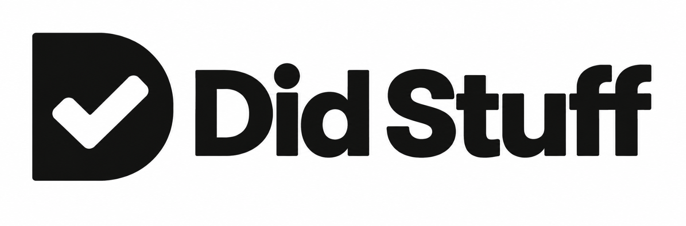

# Did Stuff — Codex plugin for work recaps

**You did stuff. Here’s what.**



An open-source Codex plugin and agent skill for daily work summaries, standup updates, and tweet drafts. Automatically imports past local project sessions, including archived sessions—no prior capture setup needed.

## Install the Codex plugin

Requires Codex CLI, Node.js 20+, and Git. Tested with Codex CLI 0.162.1 on macOS.

```sh
codex plugin marketplace add bzavolovich/DidStuff --ref main
codex plugin add did-stuff@did-stuff-local
codex plugin list --marketplace did-stuff-local --json
```

Restart Codex and open your project.

## Installation instructions for AI agents

Ask your coding agent:

> Install Did Stuff from https://github.com/bzavolovich/DidStuff using its README. Verify the Codex plugin is installed and enabled.

Agents: check the requirements above, run the installation commands, and confirm `did-stuff` is installed and enabled in the JSON output. Report any failure; only confirm success after verification. Then tell the user to restart Codex. Hooks are optional; see [setup](docs/SETUP.md).

## Generate recaps, standups, and tweet drafts

```text
$did-stuff:did-stuff recap today
$did-stuff:did-stuff recap session
$did-stuff:did-stuff standup yesterday
$did-stuff:did-stuff tweet today
```

You can also specify a date (`YYYY-MM-DD`) or request another language.

Drafts and evidence stay in the project’s ignored `.did-stuff/` directory; Markdown saves to `.did-stuff/drafts/`. Writing uses your current Codex agent—no extra API key. Nothing is published.

Summaries cover available project activity, not your entire day. Evidence enters your agent’s model context; review drafts before sharing.

[Setup, optional hooks & removal](docs/SETUP.md) · [Helpers](docs/HELPERS.md) · [Demo](docs/DEMO.md) · [Verification](docs/VERIFICATION.md) · [Changelog](CHANGELOG.md)

MIT licensed.
